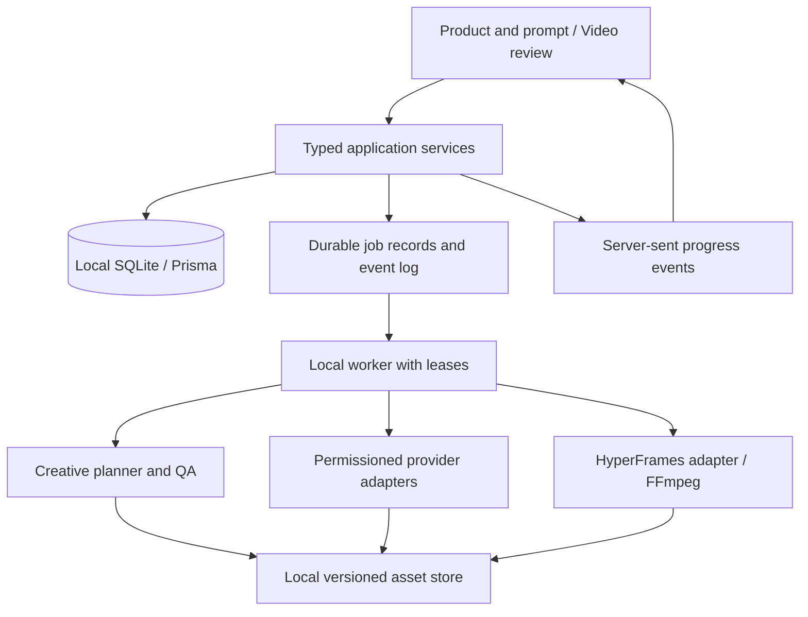

# Motion OS — Local MVP implementation plan

Version 1.0 · 30 September 2026 · Owner: Amit / PS Tech Global

Status: proposed implementation baseline based on the owner's latest direction. This is a plan, not a claim that the listed capabilities exist. Production destination: `editor.ogstart.com`, only after local quality validation and a separate launch decision.

## 1. Product promise and decisions

Select a product, describe the video, and receive a complete, coherent first draft with appropriate footage, motion, narration, captions, music, and a clear ending. Editing is an optional refinement path. Optimize for the time from intent to an accepted video, including the person's time spent correcting it.

The owner has established these priorities:

- Local-first development and production; test thoroughly on two or three real brands/use cases before hosting.
- Product context automatically supplies assets, tone, facts, audience, and visual identity.
- Short and longer videos, marketing, UGC, and explainers belong in the product direction.
- A first draft should need little or no editing. AI planning must be part of the MVP.
- A futuristic, minimal liquid-glass interface with strong typography, drawing on Relite's design.
- Quality must include storytelling, design, captions, motion, B-roll, audio, product fidelity, and naturalness.

In this plan, local-first means the application, database, original assets, revisions, and rendering operate on the owner's machine. Optional model, voice, image, and video API calls still need internet access. Each brand controls which assets may leave the machine and which providers may receive them. Downloaded outputs become local project assets. Offline access covers existing projects, editing, and supported local rendering; cloud generation is unavailable offline.

Keep the repository at `D:\OG Studio`. New standalone outputs and future configurable media storage should prefer `D:\AI-Workspace\Codex\motion-os`; create that location only with the filesystem access required by the environment. Do not relocate existing data during planning.

## 2. Relationship to existing specifications

This document is the implementation entry point for the latest direction. The existing `.agents` documents remain supporting specifications. If a requirement conflicts, the owner's latest instructions take precedence; the changes below make the differences explicit.

| Previous direction | Updated implementation decision |
| --- | --- |
| Local-first, possibly hosted later | Confirmed; hosting is gated by local production quality |
| Storyboard review at every run | Default automatic direction within saved limits; review mode remains available |
| Timeline-centered studio | Product-and-prompt home; video-first review; advanced timeline is secondary |
| AI planning in a later phase | Planning, asset selection, and complete first-cut generation are MVP work |
| Inter and neutral violet UI | New liquid-glass design brief with Relite-inspired typography and cool teal accents |
| HyperFrames first; Remotion later | Retained; protect existing Remotion work as migration reference |
| All timestamps converted only at UI boundaries | Composition is frame-based; preserve original media/word timing and convert explicitly at renderer and import/export boundaries |
| Large platform and skill-workshop roadmap | Begin with a modular local application and measured feedback; full workshop and marketplace follow demonstrated need |

Companion deliverables: [UI and UX brief](MOTION_OS_UI_UX_BRIEF.md) and [quality and local trial protocol](MOTION_OS_QUALITY_GATES.md).

## 3. MVP scope and staged breadth

The first executable slice is a 15–30 second product demo. The complete local MVP expands to the following before claiming broad coverage.

| Capability | Local MVP acceptance scope | Subsequent expansion |
| --- | --- | --- |
| Product/brand library | Versioned facts, assets, tone, locale, voice, CTA and restrictions | Catalog imports and connected commerce systems |
| Short marketing videos | 15–90 seconds, 9:16 and 16:9, original product assets plus generated supporting shots | Campaign variants and additional ratios |
| UGC | Product footage with natural voiceover; uploaded, consented creator footage supported | Generated on-camera presenter after a dedicated identity, lip-sync and product-fidelity gate |
| Longer videos | 2–5 minute explainers with chapters, story continuity and shared audio direction | 5–15+ minutes after duration and cost benchmarks |
| Generation | One validated provider per required capability; generated B-roll selectable within budget | More providers based on measured quality |
| Motion | Eight purposeful primitives and three coordinated visual families | Curated registry expansion |
| Captions | Four strong styles; word alignment; editable text/timing; SRT/VTT | Subject occlusion and complex tracked typography |
| Editing | Prompt edits, text/asset replacement, scene lock, trim/reorder, voice/music controls, undo | Expert keyframes and complex manual compositing only if demanded |
| Export | Verified 1080p MP4, thumbnail, optional sidecars, editable project bundle | Additional codecs, 4K, batch campaigns |

Generated on-camera UGC is a separate acceptance track, not implied by voiceover UGC. Until enabled, the UI clearly offers the supported format. Country and language support is enabled per tested locale, rather than advertised universally. Provisional trial languages are English plus one owner-selected language; do not infer countries from the machine timezone.

Initial primitives: kinetic title, product hero, feature/benefit card, real UI demonstration, footage with restrained annotation, comparison/proof card, chapter transition, and brand CTA. Each needs vertical and landscape layouts, a motion policy, long-text handling, and fixtures. Start with five for the first slice and add the remaining three for the complete MVP.

## 4. User experience

### One-time product setup

Create/select brand → add product/service → import approved assets and factual material → confirm extracted context → save the product profile. A product can be software, a physical item, a property, or a service.

Store primary promise, proof points, approved/forbidden claims, audience, product details, logo, palette, fonts, vocabulary, pronunciation, CTA, preferred voices, locale variants, media rights, and examples of good/bad output. Keep suggested extracted claims separate until confirmed. Product URLs are optional ingestion sources, never automatically authoritative.

Show practical readiness: “Ready to create”, “Needs product images”, or “Needs approved product facts”. Avoid a decorative percentage. A missing optional asset should not block a valid footage-free motion piece; missing evidence must block an evidentiary claim.

### Repeat creation journey

1. Select product. Its context and recent successful style load automatically.
2. Enter the prompt. Goal, language, duration, aspect ratio, and creative style are inferred from saved defaults and shown as editable chips.
3. Press **Create video**. Show planned external asset use and spending allowance when new approval is required.
4. The system develops the story, produces/selects media, assembles, reviews, and repairs within bounded limits.
5. Review a playable first draft. Primary actions: **Export** and **Make a change**. The scene strip and detailed controls open on demand.

Default **Auto** mode proceeds using confirmed product facts, provider permissions, and an owner-configured spend ceiling. **Review plan first** is optional. Ask only about material missing facts, conflicting instructions, permissions, or budget changes. Creative uncertainty should normally be resolved by the director.

Example refinement: “Make the opening faster, keep the voice and product shots.” The system creates a new revision, locks protected assets, changes relevant timing/motion, presents the resulting video, and supports Undo. Paid or identity-changing operations surface their additional scope before submission unless already covered by explicit standing authorization.

### UI surfaces

Create, Products, Library, and Activity form the compact top-level navigation. Project review contains the large player, a prompt for changes, an optional scene strip, and a contextual inspector. Settings includes providers, storage, costs, locale profiles, and defaults. Quality details and technical diagnostics are available without filling the creative workspace.

## 5. First-draft production pipeline

Each stage writes a validated artifact referencing immutable inputs. Logical roles can use one model; they do not require a fleet of independent agents or services.

| Stage | Work | Persisted output / failure behavior |
| --- | --- | --- |
| Context | Resolve product revision, prompt, language, audience, objective and limits | BriefSpec and unresolved material questions |
| Direction | Develop 2–3 compact hook treatments, choose one against brief and evidence | CreativeDirection with rationale; no media spend for discarded hooks |
| Story | Write causal narrative, claims, scene purposes, rhythm and CTA | StoryPlan with claim references and duration budget |
| Shot planning | Select real assets first where fidelity matters; identify useful generation gaps | ShotPlan: asset/source, composition, duration, role, cost, continuity |
| Preflight | Check supported capabilities, rights, product facts, budget and available assets | Executable production plan or precise blocking issue |
| Media | Reuse approved footage; generate needed narration, images and B-roll | Local AssetVersions, provider jobs, usage records and provenance |
| Timing | Measure narration, align words, adjust scene lengths and chapter pacing | AudioMap and frame-based CompositionSpec |
| Assembly | Apply layout, camera treatment, captions, transitions and mix | Compiled composition, proxy preview and render manifest |
| Critique | Run objective checks, sample frames and inspect continuity/audio | QAReport with issue location, severity, evidence and repair action |
| Repair | Resolve highest-impact issues without regenerating protected material | New revision; maximum two automatic repair passes within budget |
| Delivery | Render final, probe output, retain all reproducibility inputs | MP4, thumbnail, sidecars, immutable export record and editable bundle |

Use actual narration duration as a scheduling input. Do not force a script into arbitrary scene lengths with extreme speech speed. A longer explanation is planned as chapters with local beats, shared terms, a consistent voice, and a whole-video review for repetition and unresolved promises.

Asset selection must be semantic and chronological: an ingredient close-up belongs when discussing that ingredient, not merely because its color fits. Generated shots carry explicit purpose and continuity constraints. Preserve real packaging, logos, screenshots, and physical product detail through original assets or compositing; do not rely on a model to redraw exact labels.

Naturalness is an editorial objective: specific claims, demonstrable benefits, plausible speech, varied shot scale and rhythm, intentional pauses, and an earned CTA. Avoid automatic superlatives, repetitive hooks, generic stock montages, continuous text animation, excessive transitions, and fabricated first-person endorsements. Do not use an “AI detector” score as acceptance evidence.

## 6. Application architecture

Use a TypeScript modular monolith with a separate worker process. Keep Next.js/React for the app and existing pnpm workspaces. Use server route handlers backed by reusable domain services initially; a separate Fastify API is unnecessary for the first local loop. Long jobs never run inside a page request.



Decisions:

- Retain SQLite for the single-machine MVP, with short transactions and one initial worker. Add a repository boundary and workspace IDs now. Evaluate locking under concurrent UI/job updates. PostgreSQL and a hosted queue are pre-hosting work, not prerequisites to testing the creative engine.
- Persist a jobs table, attempts, dependency edges and worker leases. Use transactional claims, lease expiry, heartbeat, retry schedule, cancellation checks, and restart recovery. Do not replace this with an in-memory queue or a chain of timeouts.
- Start with polling inside the worker and server-sent events to the UI, with polling fallback after connection loss. Persist sequence IDs so progress survives a reload.
- Expose a RendererAdapter using HyperFrames CLI/Producer initially. Validate preview embedding and render behavior in a spike before choosing deeper SDK integration. HyperFrames' official guidance recommends CLI/Producer for most integrations; exact pixels still depend on pinned browser, fonts, codecs and host. [Engine reference](https://hyperframes.heygen.com/packages/engine)
- Media tools handle probing, proxies, normalization, mix and final verification. Keep original media time bases and sample rates in metadata.
- Provider adapters expose capabilities, quote/estimate, submit, status, cancel where supported, and download. Display account-unavailable integrations honestly.
- Keep job scheduling, provider generation and rendering replaceable behind interfaces; do not implement two render engines at once.

Suggested modules:

```text
apps/web/                  UI, typed routes, event streaming
apps/worker/               durable job execution and recovery
packages/schemas/          versioned contracts and migrations
packages/domain/           products, projects, operations, policies
packages/db/               Prisma, repositories and migrations
packages/planner/          context, direction, narrative and shot plans
packages/providers/        model/media adapters and cost accounting
packages/render-core/      adapter contract, manifest and capabilities
packages/render-hyperframes/ compilation, preview and export
packages/media/            ingest, audio, alignment and proxies
packages/quality/          deterministic checks, review and repair plans
packages/ui/               tokens and shared accessible components
fixtures/                  source-controlled small test projects
docs/                      decisions, UI direction and trial evidence
```

Avoid adding empty packages up front. Extract each module when its first working feature lands.

## 7. Data contracts and migration

Core records: Workspace, Brand, BrandRevision, Product, ProductRevision, Asset, AssetVersion, AssetRights, LocaleProfile, Project, ProjectRevision, BriefSpec, CreativeDirection, StoryPlan, ShotPlan, CompositionSpec, Job, JobAttempt, ProviderRequest, CostReservation, UsageEvent, QAReport, FeedbackEvent, ExportManifest.

Every project pins product/brand versions. Updating a brand must not retroactively modify old exports. Every artifact records schema version, input hashes, creation time, model/engine identity, prompt/template version and applicable policies. Store binaries by content hash and retain readable original filenames in metadata. Export manifests identify the exact revision and asset versions.

CompositionSpec contains stable scene/clip IDs, rational FPS, integer start/duration frames, typed primitive payloads, asset references, style tokens, audio references, caption groups, safe areas and chapter IDs. Use discriminated unions rather than unrestricted metadata for editable parameters. Invalid provider output is repaired a bounded number of times and never sent straight to a renderer.

Keep transcript word timestamps in original audio time units and retain source time bases. Convert to output frames with one documented rounding policy when compiling. Derive scene duration from cumulative boundaries to avoid drift; keep audio sample-accurate where possible. Half-open ranges prevent double-display at clip boundaries. Include 29.97-source footage, resampling, variable-frame-rate input and multi-minute alignment fixtures.

Current code migration:

1. Inventory and back up `data/studio.db` and media; inspect records without destructive reset.
2. Introduce schemaVersion 2 beside legacy millisecond contracts. Preserve the original revision.
3. Import old timelines using explicit FPS and rounding; report ambiguous timing instead of guessing.
4. Replace page-local demo state with project services and real persistence.
5. Reuse caption styles and invalidation concepts after contract tests; audit the existing static invalidation switch for timing/collision dependencies.
6. Preserve existing Remotion templates; route new supported projects through HyperFrames.
7. Test backup restore before enabling migration on working data.

A later SQLite→PostgreSQL transition needs separate migrations and data transfer verification; it is not a connection-string-only change. Prisma documents provider-specific migrations. [Migration limitations](https://www.prisma.io/docs/orm/prisma-migrate/understanding-prisma-migrate/limitations-and-known-issues)

## 8. Reliable jobs, local privacy and controlled execution

Use idempotency keys derived from project revision, job kind and input hash. Store remote request IDs immediately. If a submission times out ambiguously, reconcile with the provider when possible; otherwise stop for review instead of automatically paying twice. Reserve estimated cost before submission; settle actual cost on completion, account for retry spend, and release unused reservations.

Cancellation stops future tasks and requests remote cancellation where supported; explain when an already-submitted provider job may still bill. An export pins a revision so a concurrent edit cannot silently change its inputs. A stale client update receives a revision conflict with refresh/merge options.

Local server binds to loopback. Validate origins and protect mutations; localhost alone is not authentication against hostile web pages. Restrict file serving to known asset IDs, validate paths and uploaded content, and keep secrets server-side in the OS/environment secret mechanism.

Render reviewed templates in an isolated process with project-scoped files, bounded resources and controlled network access. Browser iframe sandboxing is an additional layer, not a substitute for worker isolation. Arbitrary generated code is outside the automatic production path. Quarantine new template code for review and fixture renders.

Per-brand external processing rules include allowed providers, allowed asset classes and any country/region constraint. Do not claim that a local interface keeps cloud-processed assets local. Assets and feedback never cross brands by default. Back up the database and content-addressed asset manifest together and test restoration.

## 9. Speed and cost engineering

These are provisional engineering targets, not promises or measured results. Benchmark on the actual machine and selected provider accounts in milestone 0. Report cold and warm runs, source duration, output resolution, cache use and queue time separately.

| Metric | Initial target / measurement |
| --- | --- |
| Common UI interactions | Visible response within 100 ms where no network result is needed |
| Product switch | Cached profile ready within 500 ms |
| Story plan | First meaningful progress within 2 seconds; usable plan target ≤45 seconds |
| 30-second asset-led draft | Median prompt-to-playable proxy ≤3 minutes; p90 target ≤5 minutes |
| Generation-heavy 30-second draft | Initial median target ≤10 minutes, provider wait reported separately |
| 2–5 minute explainer | Establish an honest baseline; prioritize chapter reuse and bounded costs before promising latency |
| Text/style refinement | Cached local preview target ≤10 seconds for the changed scene |
| Human correction effort | Target median ≤2 minutes for short drafts; track longer pieces separately |

Generate low-cost direction alternatives, not three expensive complete videos. Reuse product embeddings/metadata and approved assets. Hash caches by all material inputs, including locale, template/model version and rights restrictions. Invalidate only dependent work. Produce low-resolution proxies before full export; cap media concurrency to machine and provider limits. Prefer measured progress counts over invented percentages/ETAs.

Default one complete draft plus at most two internal repair passes. Escalate remaining problems as specific choices. Track first-pass quality separately from the internally repaired first draft. Store wall-clock time, human minutes, API cost, render compute time, cache hit rate, and accepted/rejected result. Cost per accepted production includes failed and discarded attempts.

## 10. Implementation work packages and completion gates

Effort ranges below are rough engineering planning allowances for one primary builder with ready inputs; provider access, asset preparation and review delays are excluded. Sequence is governed by working evidence, not dates. M0 updates these estimates after the runtime and renderer spikes. No estimate authorizes external spending.

| Milestone | Work and dependency | Reviewable deliverable / gate | Initial allowance |
| --- | --- | --- | --- |
| M0 — Baseline | Inventory runtime, data, dependencies, render hardware, provider accounts; capture Relite reference; choose trial products | Existing data backup, version matrix, one 10-second HyperFrames fixture, measured render report and explicit provider blockers | 1–2 focused days |
| M1 — Product and UI foundation | M0; tokens/components, product profile, create/review screens, real save/reload | Owner can select a real product, see its assets/tone, save a prompt and reopen it; glass UI works on laptop and desktop | 2–3 days |
| M2 — First complete video | M1; planner, five primitives, durable worker, HyperFrames adapter, upload/reuse, voice/audio, basic captions, export | One prompt makes a 15–30 second real product video end to end; no hardcoded scene generation, simulated preview, or fake export | 3–5 days |
| M3 — Production quality | M2; eight primitives, four caption styles, asset matching, generated B-roll, QA and bounded repairs, prompt edits | 30–90 second marketing and product/voiceover UGC; meaningful quality checks; edits preserve locked assets | 3–5 days |
| M4 — Long form and locales | M3; chapter planning, narration continuity, locale packaging, 16:9 fixtures and long-duration recovery | One 2–5 minute explainer; locale expansion tested with a fluent reviewer; no cumulative caption/audio drift | 2–4 days |
| M5 — Local production trials | M3/M4; repeated real briefs and adversarial cases; improve failures and rerun holdouts | Owner-approved scorecard for two or three products, declared supported formats/locales, measured speed/cost and remaining limits | 3–5 days plus review |
| M6 — Hosting readiness | Only after M5 and owner launch decision | Authentication, tenant isolation, Postgres/storage migration, queue/workers, backup, observability and deployment rollback validated before domain exposure | Estimate after local evidence |

M0–M2 is the first usable slice: roughly 6–10 focused engineering days under these assumptions. M0–M5 is the fuller local MVP: roughly 14–24 days, with overlap only where safe. Re-estimate rather than hiding scope or lowering quality to fit a calendar. Generated talking-head UGC has its own spike and acceptance gate; its effort is not included as a guaranteed feature in these totals.

### First executable backlog

| ID | Task | Depends on | Acceptance evidence |
| --- | --- | --- | --- |
| F01 | Baseline existing tests/build, inventory runtime and create restorable data backup | — | Report existing failures separately from new work; restore copy verified |
| F02 | Renderer spike using local fixture in both aspect ratios | F01 | Seek/preview/export frames agree within declared tolerance; missing-font failure is explicit |
| F03 | Freeze schema v2 and legacy conversion design | F01 | Valid/invalid fixtures, rounding and revision-conflict tests |
| F04 | Create glass tokens and Create/Review/Product components | Reference review | Real responsive UI, keyboard flow and readable contrast |
| F05 | Implement products, approved facts and local asset ingestion | F03 | Product context and assets persist; thumbnails/proxies retain originals |
| F06 | Implement durable job runner, events and spend reservations | F03 | Kill/restart recovery, cancellation, duplicate-submit prevention |
| F07 | Connect structured planner and shot selection | F05/F06 | Different prompts produce coherent different plans grounded in the selected product |
| F08 | Compile five scene primitives through renderer adapter | F02/F03 | Vertical/landscape fixtures; no overflow on long names |
| F09 | Integrate narration, word alignment, two initial captions and audio mix | F06/F07 | Names pronounced correctly; captions follow final audio; clean mix |
| F10 | Wire Create video through proxy, QA, final export and manifest | F04/F07/F08/F09 | End-to-end first product demo; saved project reopens after restart |
| F11 | Add prompt edits, protected fields and undo/revisions | F10 | One scene can change without regenerating unrelated paid assets |
| F12 | Add B-roll generation, four captions, quality repairs and eight primitives | F10/F11 | Product fidelity and bounded retry/cost evidence |
| F13 | Add chapter/locale paths and multi-minute tests | F12 | Long-form and selected locale acceptance report |
| F14 | Run trial/holdout scorecard, fix top failures, re-evaluate | F12/F13 | Go/no-go recommendation supported by saved videos and ratings |

## 11. Verification and local trial strategy

See [quality protocol](MOTION_OS_QUALITY_GATES.md) for the full rubric, scenario matrix and release thresholds. A working UI is not the creative acceptance test.

Test at four levels: contracts and timing, service/job reliability, visual/audio fixture renders, and real productions judged by people. Use small deterministic fixtures in routine checks; execute paid provider tests deliberately with capped budgets. Do not repeatedly regenerate identical paid media just to test composition code.

Start with three representative productions: a short software demo, a physical-product/UGC ad, and a longer explainer. Then use at least 12 fixed briefs across two or three products, repeated over two local evaluation rounds. Keep four briefs as holdouts during improvements. Two or three attractive exports alone are insufficient evidence for general readiness.

Record failures at the correct layer: bad script, inaccurate asset, wrong selection, layout/motion, caption alignment, pronunciation, render defect, latency, or confusing UX. Correct the cause before adding prompts everywhere. Preferences can be saved per product after user confirmation; global creative rules need multiple examples and regression evidence.

## 12. Missing inputs, defaults and owner decisions

The architecture and UI work can proceed while these inputs are collected:

| Input | Why needed | Planning default until supplied |
| --- | --- | --- |
| Two or three trial products/brands | Product accuracy and realistic briefs | SaaS demo, physical product/UGC, longer explainer archetypes; no invented product facts |
| First countries/languages | Narration, copy, typography, units and localization QA | English baseline plus one selected language; other locales remain unvalidated |
| Owned assets and approved claims | Brand fidelity and evidence | Import workflow first; use clearly marked fixtures for engineering |
| Provider account access and per-video budget | Real generation and cost/latency benchmark | Adapters and fixtures can proceed; production provider selected after capability/access check |
| UGC priority | Decide presenter work versus product voiceover | Product voiceover first, on-camera presenter as explicit next track |
| Hardware/storage baseline | Render targets and concurrency | Measure in M0; no GPU acceleration assumptions |
| Reviewer and reference quality | Calibrate “publishable” and naturalness | Owner is final creative reviewer; a fluent reviewer evaluates each enabled language |

Provider selection deliverable in M0: one named candidate and one fallback per needed capability, official API availability, account entitlement, supported locales/formats, upload requirements, deletion/retention controls, cost units, observed latency and a sample result. Do not infer API access from a consumer subscription or advertise an integration before it runs.

## 13. Hosting gate and forward direction

`editor.ogstart.com` remains the future destination. No public hosting is necessary to validate this MVP. After local acceptance, prepare identity, memberships/roles, tenant-scoped database and assets, remote worker authentication, signed transfers, quotas, cost metering, audit logs, deletion/export controls, recovery tests and deployment rollback. Run cross-tenant access tests before inviting external users. Select infrastructure from measured storage/render usage, not a speculative scale target.

After reliable first drafts, prioritize campaign variants, product-aware memory, multi-language adaptation, project-to-project asset reuse, and an API/MCP interface over more manual editor controls. The forward-looking advantage should be a compounding understanding of each product and lower time to an accepted video, demonstrated on real work.

## 14. Evidence and sources

- Owner's instructions in this conversation, 30 September 2026, establish local-first testing, prompt-to-video, optional editing, liquid glass UI and delayed hosting.
- Local baseline reviewed: `.agents/MOTION_OS_MASTER_PLAN.md`, supporting design/captions plans, `apps/web/src/app/page.tsx`, schema/timeline packages and Prisma schema. Main UI currently uses demo React state and keyword edits; repository is not currently a Git checkout according to project metadata.
- Relite reference: `D:\xampp\htdocs\relite\assets\css\platform.css`, `assets/css/fonts.css`, and the rendered `http://localhost/relite/onboard` page. Observed Manrope/DM Sans, warm light surfaces, forest/sage accents, rounded floating header, translucent cards and selective serif emphasis. New tokens are specified separately rather than copied wholesale.
- [HyperFrames quickstart](https://hyperframes.heygen.com/quickstart) and [engine integration reference](https://hyperframes.heygen.com/packages/engine), reviewed 30 September 2026. Pin and smoke-test the selected release before implementation; documentation is not proof of this machine's performance.
- [Prisma migration limitations](https://www.prisma.io/docs/orm/prisma-migrate/understanding-prisma-migrate/limitations-and-known-issues), reviewed 30 September 2026. Existing repository uses Prisma 6.x; check version-specific commands before running migrations.
- UI accessibility baseline: [WCAG 2.2](https://www.w3.org/TR/WCAG22/), including contrast and keyboard requirements. Reduced-motion handling is also an explicit product requirement.
